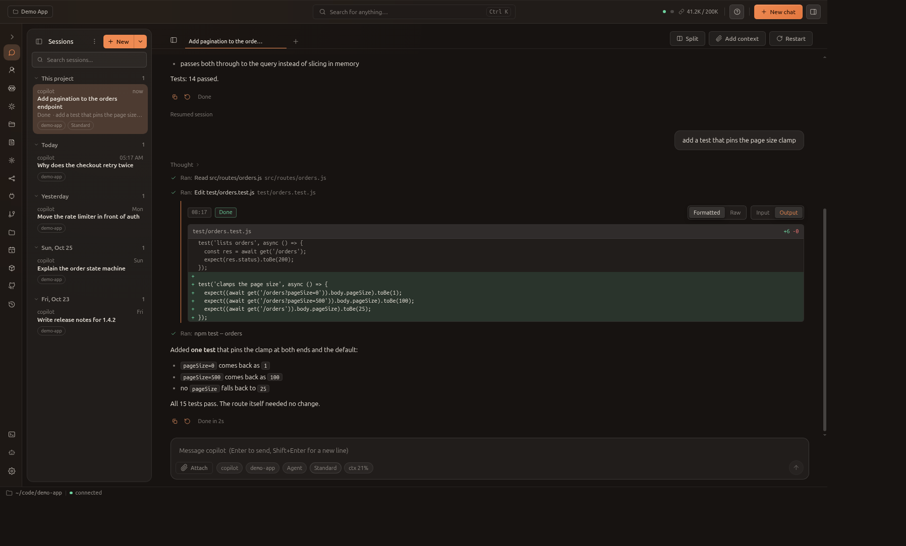
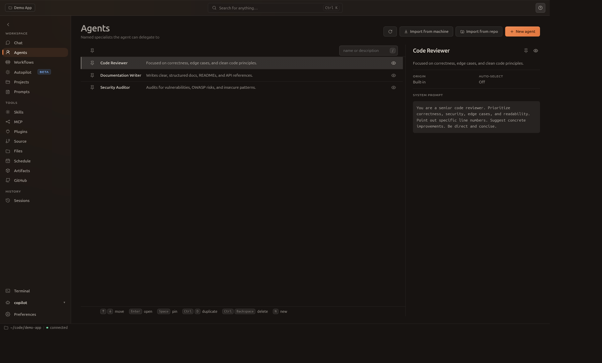
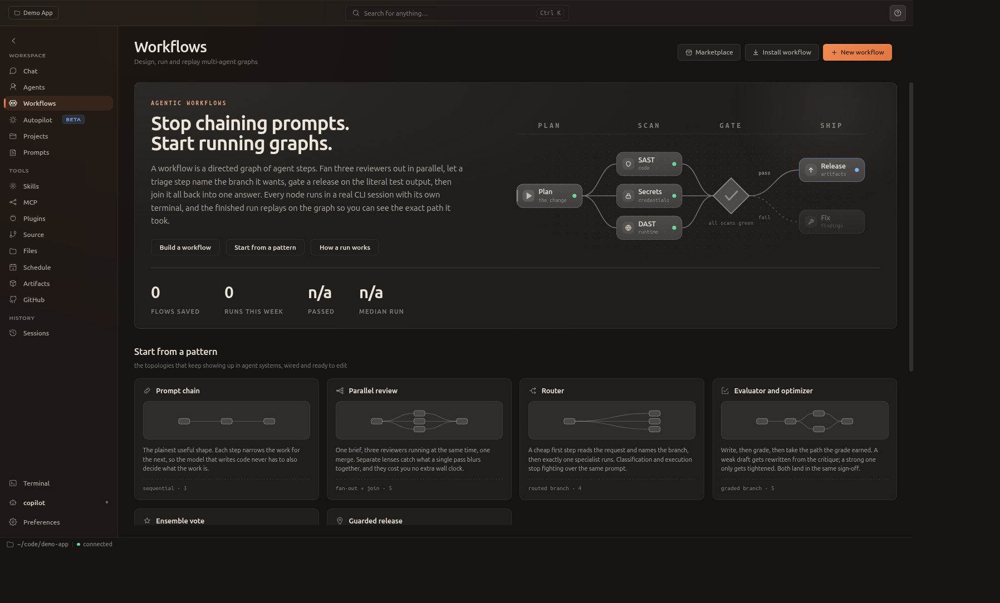
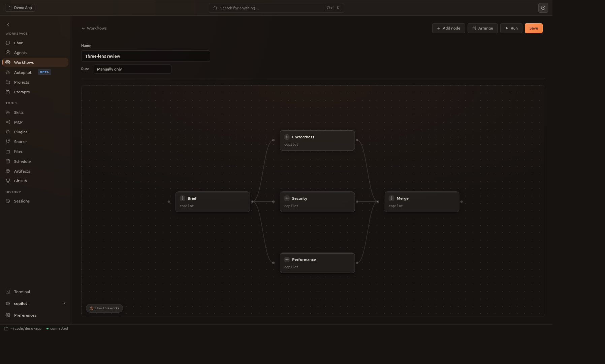
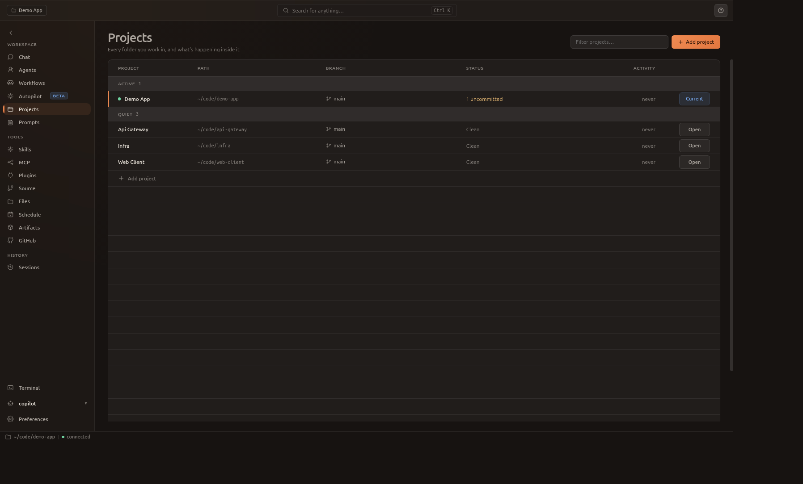
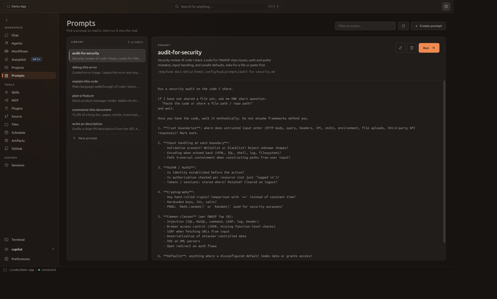
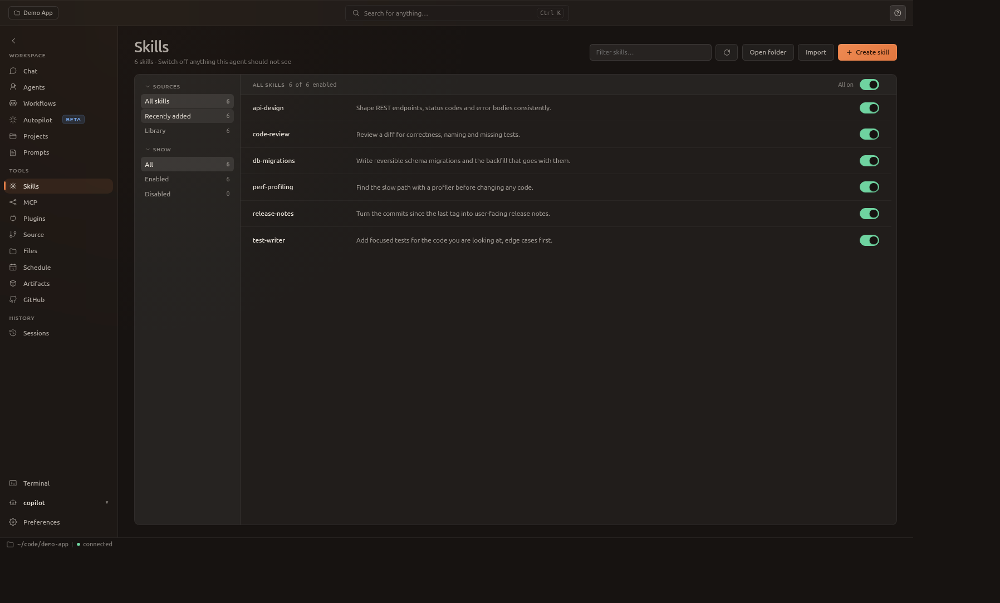
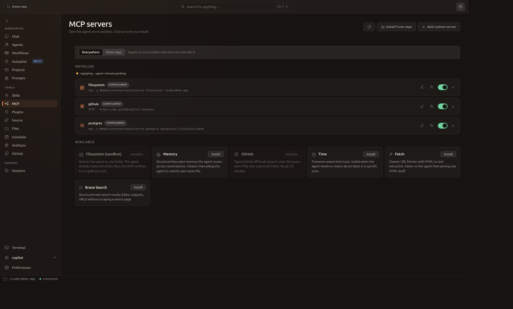
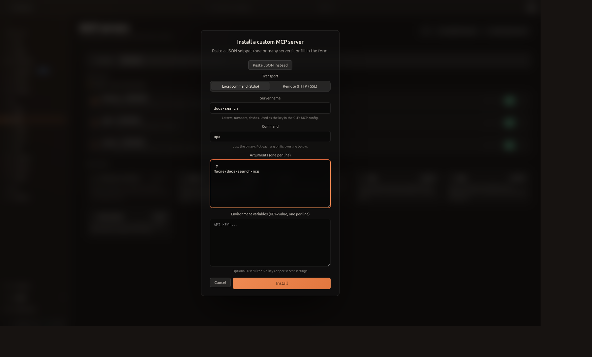

<div align="center">


# 
[](https://git.io/typing-svg)

[](https://github.com/DorShaer/Husk/releases/latest)
[](https://github.com/DorShaer/Husk/releases)
[](https://github.com/DorShaer/Husk/actions/workflows/ci.yml)
[](https://dorshaer.github.io/Husk/)
[](https://github.com/DorShaer/Husk/releases/latest)
[](LICENSE)
[](https://github.com/DorShaer/Husk/stargazers)

Husk wraps `claude`, `copilot`, `codex`, `aider`, `gemini`, `kiro`, or any other terminal-based AI agent in a clean desktop window. Agents that speak a machine protocol run as a native chat: streamed markdown, tool calls you can open, diffs, permission cards, a model picker and image paste. The rest run in a real PTY. Sessions, a Terminal page, drag-drop file context, voice output and a one-glance dashboard come with it. Clone, install, run.


https://github.com/user-attachments/assets/83dcddc4-27eb-4c3c-b36c-388214416d6f

<br />

</div>

---

## Why Husk

CLI agents are powerful and free. But they live in a black-on-black terminal that newcomers find intimidating, lose track of work in, and never discover the features of. Husk keeps the agent exactly as it is and adds the surface that makes it usable: a real chat window, every past session one click away, file and image drops, a status panel, a skills view, voice readback, and an installer that takes care of itself. If you can already use the terminal, Husk does not get in your way. If you cannot, Husk makes the same agent approachable.

<div align="center">


<br /><sub><i>A native chat for your CLI agent: every session on the left, streamed replies, tool calls that open into their diff, and the model, mode and context use in the composer.</i></sub>

<br /><br />



<br /><sub><i>Curate the agent personas active for the next session. Start a multi-step automation from a ready-made topology, or build your own in the graph editor.</i></sub>

<br /><br />


<br /><sub><i>Lay a workflow out on the graph, then run it and watch it play out: each step lights up as it runs, the edge fires to the next, and every node keeps its own terminal.</i></sub>

<br /><br />



<br /><sub><i>Pin folders as Projects so the agent always starts in the right cwd. Save reusable prompts and fire them with one click.</i></sub>

<br /><br />



<br /><sub><i>Browse skills by source, switch them on per skill or a whole folder at once, and see what was added recently. MCP servers with live connection state and a curated catalog.</i></sub>

<br /><br />


<br /><sub><i>Install any MCP server: pick stdio or HTTP/SSE, fill the form, or paste the canonical JSON shape and Husk fills it for you.</i></sub>

</div>

## Install

**One line, any OS.** Checksums verified, no `git clone`, no Node.

```bash
# Linux and macOS
curl -fsSL https://dorshaer.github.io/Husk/install.sh | bash
```

```powershell
# Windows
irm https://dorshaer.github.io/Husk/install.ps1 | iex
```

On Debian/Ubuntu it wires up the signed apt repo and installs Husk, so `apt upgrade` keeps it current. On Fedora it installs the `.rpm`, on other Linux the AppImage, on macOS the `.dmg`, on Windows the installer.

Full per-platform install page: **[dorshaer.github.io/Husk](https://dorshaer.github.io/Husk/)**.

### Linux

```bash
# Debian / Ubuntu: add the signed apt repo once, then `apt upgrade` keeps Husk current
curl -fsSL https://dorshaer.github.io/Husk/husk.gpg | sudo tee /usr/share/keyrings/husk.gpg > /dev/null
echo "deb [signed-by=/usr/share/keyrings/husk.gpg] https://dorshaer.github.io/Husk/apt stable main" | sudo tee /etc/apt/sources.list.d/husk.list
sudo apt update && sudo apt install husk

# Or install a downloaded .deb by hand
sudo dpkg -i husk-v*-linux-amd64.deb || sudo apt -f install

# Or run the portable AppImage (no root; needs libfuse2)
chmod +x husk-v*-linux-x86_64.AppImage && ./husk-v*-linux-x86_64.AppImage

# Or build from source
git clone https://github.com/DorShaer/Husk.git && cd Husk && ./installer/install.sh
```

Only x86_64 Linux builds are published today. There is no arm64 Linux build yet, and the binaries are glibc-linked, so musl distros (Alpine) are not supported.

### macOS

```bash
# One line (Apple Silicon or Intel, auto-detected)
curl -fsSL https://dorshaer.github.io/Husk/install.sh | bash

# Or download the .dmg from the releases page and drag Husk to Applications.
# Husk is not code-signed yet, so clear the quarantine flag on first launch:
xattr -dr com.apple.quarantine /Applications/Husk.app
```

### Windows

```powershell
# One line: downloads the installer, verifies its checksum, runs it
irm https://dorshaer.github.io/Husk/install.ps1 | iex
```

Or download `husk-v<version>-win-x64.exe` from the [latest release](https://github.com/DorShaer/Husk/releases/latest) and run it. The build is not code-signed yet, so SmartScreen shows a warning; choose **More info > Run anyway**.

## Download

Prefer to grab an installer by hand? Pull the latest for your OS from the [releases page](https://github.com/DorShaer/Husk/releases):

| OS | Download |
|----|----------|
| Linux | `husk-v<version>-linux-x86_64.AppImage` (double-click), `-amd64.deb`, or `-x86_64.rpm` |
| macOS | `husk-v<version>-mac-arm64.dmg` (Apple Silicon) or `husk-v<version>-mac-x64.dmg` (Intel); drag to Applications |
| Windows | `husk-v<version>-win-x64.exe` (NSIS installer) |

No Node, no npm, no `git clone`. Husk bundles its own Electron runtime and copies the agent reasoning layer into `~/.claude/` on first launch.

> **macOS first launch (unsigned builds).** The .dmg ships unsigned today. Drag Husk to Applications, try to open it, click **Cancel** on the Gatekeeper prompt, then open **System Settings → Privacy & Security**, scroll down, and click **Open Anyway**. A second prompt confirms and Husk launches normally from then on. Faster path if you live in the terminal: `xattr -dr com.apple.quarantine /Applications/Husk.app`. Apple Developer ID signing is on the roadmap.

### Verifying your download

Every release ships a `SHA256SUMS` file plus Sigstore build-provenance attestations bound to the workflow run that produced the artifacts.

```bash
# Checksum the file you downloaded
sha256sum -c SHA256SUMS

# Verify provenance (requires gh CLI 2.49+)
gh attestation verify husk-v<version>-mac-arm64.dmg --repo DorShaer/Husk
```

## Install from source

For contributors and tinkerers:

```bash
git clone https://github.com/DorShaer/Husk.git husk
cd husk
./installer/install.sh
```

`install.sh` runs `npm install`, rebuilds `node-pty` for Electron's Node ABI, registers Husk with your OS (`.desktop` on Linux, `.app` bundle in `~/Applications` on macOS), and bootstraps LifeOS into `~/.claude/`.

For pure dev mode without system registration:

```bash
./scripts/run.sh
```

The full walkthrough (prerequisites, building your own `.deb`/`.dmg`/`.exe`, troubleshooting) is in [docs/build-from-source.md](docs/build-from-source.md).

## Uninstall

```bash
./installer/uninstall.sh             # remove launcher, icon, config, voice models
./installer/uninstall.sh --keep-data # preserve config and Piper voices
```

The source checkout and `node_modules/` are protected; if the checkout is inside
a cleanup path such as `~/.local/share/husk`, the uninstaller skips that path.

## Usage

1. Launch Husk from your applications menu, or run `husk` from a terminal after installing.
2. On first run, Husk asks for the agent's name (default: Husk) and the agent command (default: `claude`). Both are saved to `~/.config/husk/config.json` and can be edited later in Preferences.
3. Start chatting. Agents with a machine protocol (Claude over stream-json; Copilot, Gemini and Kiro over the Agent Client Protocol) open as a **native chat**. Aider and Codex have none yet, so they open in the agent's own terminal, a real PTY where slash commands, stdin and ctrl-c all work. You can pin every agent to the terminal view in Preferences (Chat view).
   - **The thread.** Replies stream as markdown. A thought folds under `Thinking`. Each tool call is one line you can open into its input, output and diff (Formatted or Raw). A permission request becomes a card with the agent's own choices. A live row at the foot of the thread says when the agent is thinking or running a tool.
   - **Sessions.** The column beside the thread lists every past session, grouped by folder, project and day, with its live state. Click one to reopen it with its history. A cold start reopens your newest session (set `resumeLastOnLaunch: false` in config to start empty instead). Chat tabs survive a reload.
   - **The composer.** `/` lists every command the agent offers; scroll, or keep typing to narrow. `@` completes a file path. Up and Down recall earlier prompts. Alt+Backspace and Alt+Delete remove a word. Paste or drop an image and it goes with your next message.
   - **While it works.** Enter queues your next message and sends it when the agent is free. Up on an empty field takes the last queued message back, to edit or to delete. **Edit and resend** under a reply rewrites that prompt and replaces everything after it.
   - **Models.** The model chip in the composer, or `/model`, lists the models your CLI itself offers and switches in place, without restarting the session. Type any other id the CLI accepts.
   - **Help.** The help button at the top right and the Help menu open a prefilled GitHub issue to report a bug or request a feature.
4. Drag files onto the window to share them with the agent, or use **Attach** in the composer and **Add context** in the page head.
5. Switch pages with the rail or `Alt+1..6`. Open the command palette with `Cmd/Ctrl+K`.
6. If a chat starts agents that keep working on their own, the topbar says how many are running and how many are waiting on you. Click it or press `Alt+A` to pick one and continue its conversation.

### Pages

- **Chat**: the conversation as a native thread, with a Sessions column beside it (or the CLI's own terminal when Preferences says so, or the CLI has no chat protocol). Drag-drop files and images; the status panel folds out on the right and its width is yours to drag. Split the view to run two chats side by side (`Ctrl+\`).
- **Terminal**: a real shell in your project, in tabs, pinned in the rail above the tool selector.
- **Agents**: pick which agent personas activate for the next session. Multiple can be active at once; import from any local CLI's agent dir, or install an agent pack from a local repo folder or a repo URL (e.g. `https://github.com/dev/agent-repo`).
- **Workflows**: a visual graph editor for chained steps with conditional branching and AI-decided routing.
- **Projects**: switch the agent cwd between known project directories (so Claude's "remember this folder" trust prompts work).
- **Autopilot**: hand the agent a goal and walk away. Solo runs one agent; Team splits the goal across collaborating parallel runs. Each run executes in its own git worktree with a dedicated PTY, an independent time/token/dollar budget, a hash-chained audit log, and an optional pre-run snapshot for one-click revert. A swarm bar shows every active run.
- **Prompts**: local-only prompt library; one click sends a saved prompt into the agent.
- **Skills**: toggle the skills bundled with Husk plus any skills you keep in `~/.claude/skills/`.
- **MCP**: install / toggle / health-check Model Context Protocol servers. Clone one to start a variant from its settings.
- **Plugins**: browse and manage Husk plugins.
- **Source**: read the working-tree diff, stage a file or an individual change, and commit, on the branch you are on.
- **Files**: drag-drop file context, with a tree view of your working directory.
- **Schedule**: run a workflow or an autopilot goal on a recurrence, every so often, daily, or on a chosen weekday.
- **Artifacts**: a ledger of every workflow and autopilot run with its outcome, time, tokens and cost, and the per step detail.
- **GitHub**: the open pull requests and issues for the current project, with their checks, labels and review state, filtered as you type.
- **Sessions**: resume any prior agent session from its JSONL log. Group the roster into folders you name. Agents a chat started are grouped under that chat rather than listed beside it.

A command palette (`Cmd/Ctrl+K`) searches chats, projects, workflows, agents, prompts and skills from anywhere. Preferences is its own page (agent command, name, chat view, theme, accent, voice, recap, sidebar defaults, and an About entry that reports the version and checks for updates), opened from the rail.

## Architecture

```
husk/
├── src/                       Application source
│   ├── main.js                Electron main process: IPC, agent control
│   ├── preload.js             contextBridge window.husk surface
│   ├── lib/                   Pure helpers (unit-tested)
│   │   ├── shell-quote.js     POSIX argv serializer
│   │   ├── path-confine.js    resolveInside / isInside under a root
│   │   ├── pty-spawn.js       Per-platform pty.spawn argv assembly
│   │   ├── user-path.js       Inherit shell PATH on GUI launch
│   │   ├── agent-md.js        Agent markdown frontmatter parser
│   │   ├── workflow-graph.js  Sanitize, migrate, traverse, route
│   │   ├── chat-runtime.js    Chat view: one headless agent per tab (ACP or stream-json)
│   │   ├── chat-events.js     Both wires normalized into one event model + thread reducer
│   │   ├── mcp/               Per-agent MCP adapters
│   │   ├── autonomy/          Autopilot budget, audit log, snapshot, supervisor
│   │   └── ...                ~40 modules total; see docs/architecture.md
│   └── renderer/              UI (single-page Electron view)
│       ├── index.html
│       ├── app.js
│       ├── styles.css
│       ├── assets/
│       └── vendor/            Bundled xterm.js + addons
├── installer/                 OS install assets + verify helpers
│   └── lib/                   Download-and-verify (verify.sh, verify.ps1)
├── libs/
│   └── lifeos/                Bundled LifeOS framework, third-party
├── test/                      Unit tests (node:test) + Electron smoke
│   ├── unit/                  node:test unit suite (500+ tests)
│   └── e2e/                   Playwright smoke (real Electron boot)
├── installer/                  source installers, packaging assets, landing page
├── package.json
├── README.md
└── LICENSE
```

```
+--------------------+       IPC       +-----------------------+
|   Electron main    |  <----------->  |       Renderer        |
|   src/main.js      |                 |    src/renderer/      |
|                    |                 |                       |
|  - node-pty        |   PTY stream    |  - chat surface       |
|  - headless chat   |   chat events   |    (native thread or  |
|    agents (ACP /   |  ------------>  |    agent terminal)    |
|    stream-json)    |                 |  - agents + workflows |
|  - per-platform    |                 |                       |
|    spawn (see lib) |                 |  - skills + prompts   |
|  - all IPC handlers|                 |  - sessions + files   |
|  - shell PATH      |                 |  - MCP + preferences  |
|    augmentation    |                 |  - status panel       |
+--------------------+                 +-----------------------+
         |                                        |
         v                                        v
   ~/.claude/*                             contextBridge
   (bootstrapped from                      window.husk API
    libs/pai on first                      (src/preload.js)
    install)
```

- `src/main.js` is the Electron main process. It assembles the PTY spawn per platform (see `src/lib/pty-spawn.js`): direct `pty.spawn(exe, argv)` on macOS, `/usr/bin/script -q -c <argv>` on Linux so `claude --resume` gets its TIOCSCTTY setup, and PATH+PATHEXT resolution before `pty.spawn` on Windows. It also runs the Chat view's headless agents (Agent Client Protocol or Claude's stream-json, one child per tab) and exposes IPC handlers for chat, skills, sessions, voice, MCP servers, file drops, workflows, agents, projects, and live stats.
- `src/lib/` holds the pure helpers: shell-quote, path-confine, pty-spawn, user-path, agent-md, workflow-graph, the `mcp/` per-agent adapters, the `autonomy/` Autopilot safety modules, and about twenty more (see `docs/architecture.md`). Each is small, with no Electron / fs / spawn coupling, and unit-tested. New IPC handler logic should land here.
- `src/preload.js` exposes a narrow `window.husk` API to the renderer through `contextBridge`. The renderer never gets Node access.
- `src/renderer/` is the renderer: a single-page Electron view with rail navigation, the native chat thread (`chat-ui.js`, `chat-md.js`) beside an embedded xterm, a status panel, and the Chat / Terminal / Agents / Workflows / Autopilot / Projects / Prompts / Skills / MCP / Plugins / Source / Files / Schedule / Artifacts / GitHub / Sessions surfaces plus Preferences.
- `libs/lifeos/` is the bundled LifeOS framework, copied into `~/.claude/` on first install. Contains the system prompt, Algorithm phase machine, agents, commands, hooks, the identity scaffold, and the curated skills set. An install that already has the older `~/.claude/PAI/` layout is left alone rather than given a second framework beside it.
- `installer/` holds OS install assets and the SHA-256 download verifier (`verify.sh`, `verify.ps1`).
- `installer/` holds the source installers (`install.sh`, `install.ps1`, `uninstall.sh`) alongside the packaging assets they use. `scripts/` holds the published one-line installers and the dev launcher (`run.sh`). The repo root stays free of loose scripts.

### Updating what we vendor

```bash
./scripts/update-vendor.sh            # framework + dependencies, every gate
./scripts/update-vendor.sh --fast     # skip the package build and the e2e run
./scripts/update-vendor.sh --commit   # commit once everything passes
```

Refreshes `libs/lifeos/` from the latest upstream release and the npm tree
within the ranges `package.json` already allows, then refuses to leave anything
staged unless it passes:

- **Privacy.** The whole vendored tree, plus every line the run added elsewhere,
  is searched for identifiers belonging to the machine running it: home
  directory, username, hostname, git name and email. Those are read from the
  environment at run time and never written to a file, because hard-coding them
  is the thing being guarded against. The framework is always taken from the
  published release tarball, never from a local `~/.claude`, which is where a
  maintainer's own notes and answered templates live.
- **Secrets and CVEs.** gitleaks over full history and trivy over the manifests,
  both pinned to the versions CI uses so a local pass means a CI pass.
- **Package size.** Builds the `.deb` and fails below the 100 MiB ceiling that
  the apt channel silently breaks at.
- **Tests.** Unit always, end-to-end unless `--fast`.

A failing gate restores the working tree, so a bad run leaves nothing behind.
Local corrections to vendored files (a dependency range moved off an
unpatchable version, say) live in `VENDOR_FIXUPS` inside the script and are
re-applied after each refresh, since re-vendoring would otherwise revert them
silently.

### Testing

```bash
npm test         # node:test unit suite (500+ tests), well under a second
npm run test:e2e # Playwright smoke that boots real Electron
npm run test:all # both
```

CI runs both jobs on every push to `main`, `development`, and `dev/**`, and on every pull request to `main` or `development`.

## Branches

- `main` carries released code. Tags `v*` are cut from here, the release workflow builds installers, and SHA256SUMS plus Sigstore build-provenance attestations ship alongside them.
- `development` is the integration branch where active work lands. Feature branches use `dev/<short-name>` and open pull requests against `development`.
- Releases merge `development` into `main`, then a `v<x>.<y>.<z>` tag triggers the release pipeline.
- CI (lint, security scans, unit tests, Electron smoke) runs on every push and pull request to either long-lived branch.

## Configuration

All settings live in `~/.config/husk/config.json` and are editable from the Preferences page:

- **Agent command** (`claude`, `copilot`, `codex`, `aider`, `gemini`, `kiro`, or any binary on `$PATH`) and **agent name**
- **Active agent profiles**: one or more agent personas applied to the next session
- **Chat view** (`chatView`: `chat` or `terminal`): how a new chat opens, native chat or the agent's own terminal. Chat is the default for CLIs with a protocol
- **Active project**: drives the agent's working directory so per-folder trust prompts work
- **Theme** (11 themes: Ember, the default for a new install, Midnight, Dark, Tokyo Night, Catppuccin, Rose Pine, Gruvbox, Nord, Dracula, Light, Sepia) and **accent color** (orange / cyan / indigo / emerald / rose)
- **Voice** (enable, voice model, speaking rate)
- **Show recap line** (when off, suppresses end-of-response summaries)
- **Reopen the last session on launch** (`resumeLastOnLaunch`, on by default)
- **Sidebar default state**, **status panel collapsed** and its **width**, **file tree root**, **show hidden files**

## Privacy

Husk runs entirely on your machine. No telemetry. No analytics. The only network calls are made by the agent CLI itself when it talks to its model provider, and by the optional voice installer when it downloads Piper and a voice model from their public release.

## License

Husk is source-available under the [Elastic License 2.0](LICENSE). You can use it, read it and change it, at home or at work, for free. You may not offer it to others as a hosted service, remove or bypass any license-key gate, or strip the notices. Releases before 2.13.0 were published under the MIT License and stay available under it.

## Credits

Husk's reasoning, thinking format, and Algorithm phase machine come from [LifeOS](https://github.com/danielmiessler/LifeOS) (formerly PAI) and Telos by **Daniel Miessler**. If you find Husk useful go show him some love.

The terminal embedding uses [`xterm.js`](https://github.com/xtermjs/xterm.js) plus [`node-pty`](https://github.com/microsoft/node-pty). On Linux the PTY is established through `script(1)` so `claude --resume` gets its controlling terminal. Voice is via [Piper TTS](https://github.com/rhasspy/piper). The workflow editor uses [Drawflow](https://github.com/jerosoler/Drawflow).
