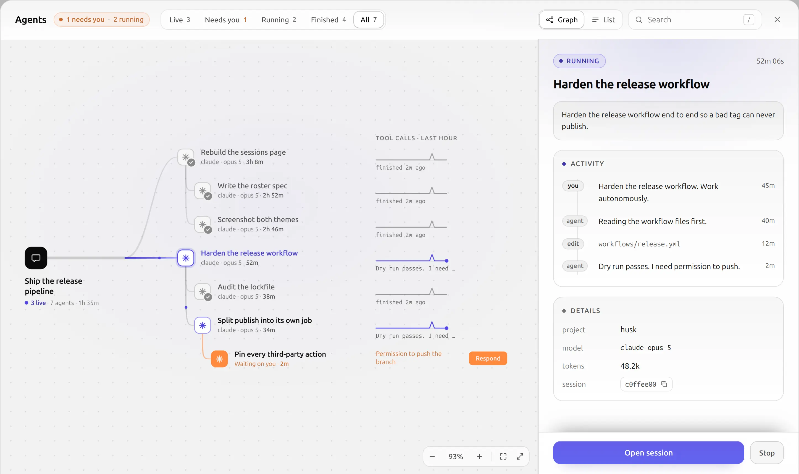

# Background agents

When a chat starts agents to work on separate tasks, open the live Agents map from the count in the top bar or press `Alt+A`. The map shows how the agents relate to the chat, what each one is doing, and recent tool activity.

Use the filters to focus on agents that are live, running, waiting for you, or finished. Select a node to read its activity and details. If an agent needs an answer, respond from its activity panel. **Open session** returns to that agent's conversation.

The Agents page on the navigation rail manages the personas available for future chats. The live map follows agents already started by a chat.
