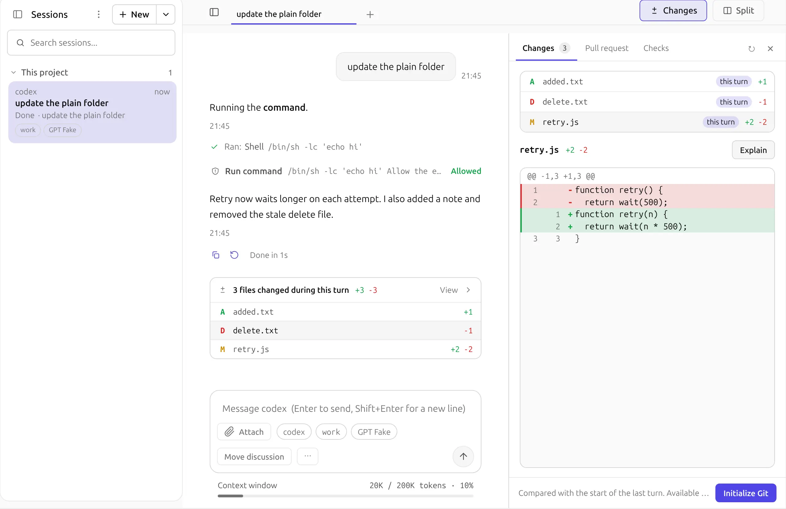

# Chats, rules and usage

## Choose a CLI or folder

The New menu lists the installed CLIs, with the most recently used first. Each entry names the folder it will open in. Terminal starts a regular shell. With one detected CLI, the menu uses the shorter New chat label.

In a native chat, select the CLI chip or the folder chip in the composer to change context. Choose **Continue this discussion** to carry a transcript into the new session, or **Start fresh** for an empty thread. If a reply is running, confirm that it should stop first.

A continuation includes user messages, assistant replies, brief tool summaries and changed filenames. Raw tool output and private reasoning are not copied. Long histories are supplied through a private local file that the receiving CLI is asked to read. The first new prompt displays a continuation notice.

In the chat's Sessions column, Continue with another CLI is available from a saved session's context menu. The source conversation remains on disk. Context injected for a continuation is hidden from restored message bubbles and session titles.

Terminal-only CLIs receive continuation text through the terminal paste path. Review that text and submit it in the CLI. A terminal-only CLI does not gain a native history reader or a normalized transcript reader through this feature.

## Answer an agent's questions

Claude and Codex can display questions as selectable cards inside the thread. Pick an option, or type an answer when offered, then select Submit. Dismiss returns no answer. Questions still ask for your input when Allow all is enabled. A pending Codex question survives Ctrl+R while its agent process is running; the card closes if Codex withdraws the request. Non-blocking questions stay available while the agent continues working.

Codex uses the [app-server question protocol](https://developers.openai.com/codex/app-server#toolrequestuserinput), with answers returned by question id. Start a new Codex agent process after updating Husk to enable the client capability.

## Local transcript retention

Native chat events are recorded under the Husk config directory in `transcripts/`. The files contain conversation data and should be treated as private. Each file is bounded to 2 MiB; older content is replaced by a truncation notice as needed. Tool output is shortened and thoughts are not retained by this store.

**Preferences > Workspace > Transcript retention** controls startup pruning, with a default of 30 days. Zero disables age-based pruning. Private large-handoff files use the same retention period. This setting does not delete the underlying CLI's own history.

## Brain rules

Use Add rule, or select Make this a rule on a note. Rules are explicit user instructions, separate from recalled reference notes. They apply to all workspaces by default and can be limited to the current workspace.

Rules bypass text similarity matching. Pinned rules go first, followed by newer ones. The prompt budget allows up to 12 rules and about 800 characters; the Rules tab identifies overflow. Each rule is limited to 300 characters. Turn a rule off to keep it without sending it, or stop using it as a rule to restore normal note recall.

Chat prompts receive active rules on each ordinary turn. Slash commands retain their native behavior. New terminal sessions receive rules through the existing instruction channel; restart a terminal session after changing its rules. Delivering an instruction does not force a CLI to follow it.

Captured conversations and imported files cannot silently become rules.

## Usage bell and budgets

The bell lists available plan, context-window and local daily-budget readings. Missing readings mean unknown usage, not unlimited usage. Warnings default to 75 percent and critical warnings to 90 percent; both thresholds are configurable in Preferences > Usage & limits.

The badge counts unread alerts. Opening the bell clears the badge while keeping the usage readings visible. Alert state is stored locally, so Ctrl+R and app restarts do not repeat the same toast or restore a viewed badge. A new source, a higher warning level or a new usage window can raise a new alert. A changed reset estimate is not a new window; the previous window must end first. Temporary healthy readings do not rearm an existing plan alert. Records expire after 30 days and storage keeps the latest 200 sources.

Direct plan readings retain their existing default and can be disabled. With the direct source off, Husk relies on CLI-reported plan events. Other CLIs can still report context or reach their own limits without providing a plan percentage.

Daily budgets count usage observed in Husk's native chats. They exclude other applications and unreported usage. Cached input is included when reported. Resumed session counters establish a fresh observed baseline. Dollar figures are approximate CLI estimates, not bills; subscription list prices are excluded. Running cost totals are converted to deltas rather than added repeatedly. See the [upstream cost semantics](https://code.claude.com/docs/en/agent-sdk/cost-tracking#track-costs-in-streaming-input-mode).

Optional budget confirmation holds a message before sending. Cancel keeps a typed draft or restores an automatically dequeued message to the queue. Budgets reset at local midnight. A budget is a local reminder, not an account-wide provider limit or an authoritative spending control.

Recovery actions depend on the resource. Context warnings offer native compaction when supported, a new conversation with the same vendor, and dismissal. Codex uses its native thread compaction API; older versions that reject it show an error and keep the existing conversation. Compaction requested during a reply runs before queued messages. Drafts and the current thread are preserved. Husk only updates the context meter from reported usage.

Provider limits offer usage details and switching only when another installed CLI is detected and has no known reached limit. With one vendor, no switch is suggested. Local budgets link to Usage settings. An error-text match is labeled as a possible limit because it is inferred.

## Files changed during a turn

A completed turn that changes files adds a receipt to the conversation. Select a file or View to open its diff in Changes; Explain sends a question about that file to the active chat. Changes made by other applications during the same turn can also appear.

This works in folders without Git. Husk compares local files before and after the turn without creating tracking files. Non-Git diffs remain available until the next turn or app restart. Common dependency and build folders, environment files, private-key files and symbolic links are skipped. Comparisons are bounded to 2,000 files, 4 MiB of file content and a two-second scan; files over 256 KiB and binary files have no line diff. The Changes view identifies incomplete comparisons.

Select **Initialize Git** in Changes to create a repository in the working folder. Review the folder in the confirmation. This runs Git initialization only: no commit or remote is created. Pull requests and checks continue to require a Git repository and a configured remote.

Git does not need to be installed for local turn comparisons. When Git is missing or cannot start, Changes and Source offer **Get Git** and **Check again**. After installing Git in a location on Husk's PATH, Check again enables the repository actions without restarting Husk. If it was installed into a new location that Husk cannot see, restart Husk after updating PATH.

Git setup refuses existing repositories, nested repository folders and worktree markers. Read-only or missing folders, initialization failures and timeouts show an explanation. Canceling the folder confirmation leaves it unchanged. If Git becomes unavailable during a Git-tracked turn, Husk reports that it could not compare that turn; local comparison starts on the next turn. Partial scans are labeled rather than reported as a clean folder.
